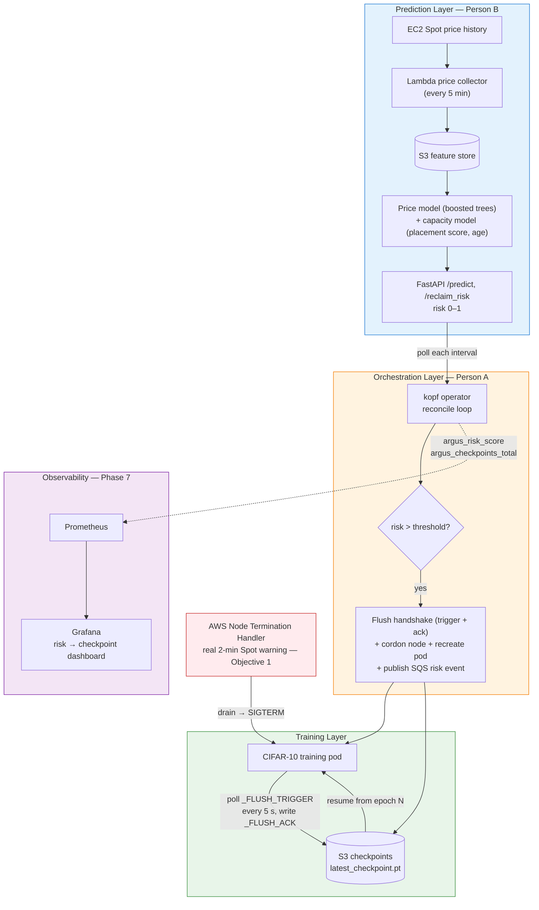

# Argus — Spot-Resilient ML Training Orchestrator

[](https://github.com/Angshuman1211/Argus-Spot_Resilient_ML_Training_Orchestrator/actions/workflows/tests.yml)
[](LICENSE)
[](ml/api/Dockerfile)
[](helm/argus)
[](docs/objective1_result.md)

A three-layer system that predicts EC2 Spot interruptions and automatically checkpoints + migrates running ML training jobs, with no human in the loop. Both the reactive path (AWS's 2-minute notice) and the predictive path (operator acts on a risk score) run end to end on real AWS EKS. The predictor is evaluated in a trace-driven benchmark and against 152 real Spot reclaims.

**Project page:** [angshuman1211.github.io/Argus-Spot_Resilient_ML_Training_Orchestrator](https://angshuman1211.github.io/Argus-Spot_Resilient_ML_Training_Orchestrator/) · **Paper:** [arxiv.org/abs/2609.39067](https://arxiv.org/abs/2609.39067) (*When Does Predicting Spot Interruptions Beat Checkpointing? A Trace-Driven Study with Real Reclaims*). To see it run locally: `python demo/run_demo.py`.

> **Status: v2 (October 2026).** Weeks 1–8 built the system; the v2 round answered the ML4Sys 2026 workshop reviews: the predictor now has to actually predict (trace-driven benchmark with its own causal scores), it was retrained on 100x more data, tested against real reclaims from a sensor fleet, and the full predictive path was run on real EKS. Findings in one line: reacting to the notice is enough while a checkpoint fits in 2 minutes; beyond that a good predictor beats periodic checkpointing, but price history does not predict real reclaims, while AWS's placement score does.

---

## Architecture



**Two interruption paths converge on the same SIGTERM → checkpoint → reschedule → resume flow:** the *predictive* path (operator sees risk cross the threshold and pre-migrates) and the *reactive* path (AWS's real 2-minute Spot warning via the Node Termination Handler — validated on real EKS in Objective 1).

---

## The problem

EC2 Spot instances are ~70–90% cheaper than On-Demand but can be reclaimed on **2 minutes' notice**. A long ML training job that ignores this loses everything since its last checkpoint on every interruption — wasted GPU-hours and a non-deterministic finish time. Argus keeps the job alive across reclaims automatically.

## How it works

| Layer | What it does |
|-------|--------------|
| **1. Prediction** (Person B) | Lambda pulls Spot price history every 5 min → S3 feature store. A gradient-boosted model scores the chance of a price spike (`/predict`); a second model trained on real reclaims scores reclaim risk from AWS's placement score and the node's age (`/reclaim_risk`). Both served by FastAPI. |
| **2. Orchestration** (Person A) | A `kopf` Kubernetes operator (the `SpotResilientJob` CRD) polls the risk every minute (`riskSignal: price` → `/predict`, threshold `0.05`; `riskSignal: capacity` → `/reclaim_risk`, threshold about `0.16`; both a 10% alarm budget). Above the threshold it writes a request id to `_FLUSH_TRIGGER`, waits for the pod to echo it in `_FLUSH_ACK`, cordons the node, deletes the pod and recreates it from a snapshot on another node, then publishes an SQS risk event. A 15-minute cooldown stops it chasing a pool whose risk stays high. With `gang: true` a synchronous multi-node job (all pods labelled `argus.io/job=<name>`) is moved as one: the risk of every member's node is read, one flush covers the job, only the risky nodes are cordoned, and every member is recreated so they resume from the same checkpoint. |
| **3. Training** | The CIFAR-10 job polls the trigger every 5 seconds, saves the checkpoint to S3 and acknowledges it; a SIGTERM handler checkpoints on drain; the replacement pod resumes from the last epoch. |

The checkpoint mechanism is deliberately **decoupled** — the operator only *signals*; the training pod owns the flush — so the operator never touches training-process internals.

---

## Results

### Objective 1 — Survived a real Spot drain on real EKS

Validated on **real Spot nodes** (`c5.xlarge`/`m5.xlarge`) with IRSA (zero static credentials) and the AWS Node Termination Handler in queue mode. Training was live at **epoch 7** when the interruption fired:

| t (UTC) | Event |
|---------|-------|
| 12:26:18 | NTH receives `EC2 Spot Instance Interruption Warning` |
| 12:26:19 | Requesting drain → evicting pod `cifar10-test` (graceful SIGTERM) |
| 12:26:19 | SIGTERM handler **writes checkpoint (epoch 8) to S3** |
| 12:26:25 | Node cordoned + drained — **10 s** end-to-end |
| +~75 s | Replacement pod on a healthy node → **"Resuming from epoch 8"** |

Only the in-progress epoch's work was lost. The real checkpoint written to S3 during the drain:


> **Honest scope:** the interruption was delivered by injecting a **schema-conformant** `EC2 Spot Instance Interruption Warning` into NTH's queue — NTH cannot distinguish it from a real reclaim, so the drain → SIGTERM → checkpoint → resume path is genuinely exercised. A *forced* AWS reclaim (FIS `send-spot-instance-interruptions`) is future work, blocked on an account-subscription issue, not the design. See [`docs/objective1_result.md`](docs/objective1_result.md) and ADR-007 / P-019 in [`docs/problems_and_decisions.md`](docs/problems_and_decisions.md).

### Objective 2 — When does prediction actually pay?

A controlled benchmark (4 arms × 4 interruption rates × 5 reps = **80 trials**, Poisson-scheduled kills). Results at the fastest rate (MTBF = 120 s):

| Arm | Completion | Wasted compute (s) | Makespan (s) | Checkpoints |
|-----|-----------:|-------------------:|-------------:|------------:|
| no-protection | 100% | 202.3 | 361.8 | 0 |
| reactive-on-notice | 100% | 169.4 | 328.0 | 4.8 |
| periodic | 100% | 4.3 | 158.8 | 24.0 |
| predictive (fixed 600 s lead) | **20%** (1 of 5) | 0.0 | 353.2 (1 run) | 221.6 |

What the table shows: **reactive's fixed 2-minute notice stops helping exactly when interruptions come faster than once per ~2 min** (at 120 s MTBF the notice ≈ the interval, so reactive degrades toward no-protection). Predictive's one clean win is **zero wasted compute**, but with an oversized lead it over-migrates and only 1 of 5 runs completes, so its makespan is from a single run. *Periodic* checkpointing, with no ML, matches it on waste and wins on makespan and checkpoint count. In this benchmark the predictive trigger is a configured lead time, not model output (see `Paper/fix_everything_plan.md`). Full table + figures: [`docs/objective2_result.md`](docs/objective2_result.md), [`benchmark/results/`](benchmark/results/).

#### Trace-driven re-run (v2): the predictor has to actually predict

The table above uses Poisson kills and a configured lead time, so it cannot test prediction. The v2 benchmark
replays real eu-north-1 Spot price history with the model's real, causal risk scores driving the policy, on a
synchronous multi-node job (`benchmark/trace_sim.py`, 20 tests, hundreds of thousands of simulated runs). The
latest slice is 4 to 13 October (66 price-spike events); the alarm budget is chosen on a separate calibration
slice. Slowdown vs ideal at 15 nodes (1.0 = no loss), checkpoint cost 10 s / 60 s / 300 s:

| Policy | 10 s | 60 s | 300 s |
|---|---:|---:|---:|
| no protection | 4.25 | 4.25 | 4.25 |
| reactive on 2-min notice | **1.02** | **1.02** | 4.25 |
| periodic, Young-Daly interval | 1.06 | 1.14 | 1.34 |
| old model alarms (same 10% budget) | 1.82 | 1.92 | 2.48 |
| **retrained model alarms** | 1.06 | 1.07 | **1.14** |
| oracle (5 min perfect warning) | 1.01 | 1.01 | 1.03 |

Findings: reactive is best while a checkpoint fits the 2-minute notice; once it does not (large models),
reactive collapses and the retrained model beats every non-learned baseline (1.14x vs 1.34x for Young-Daly,
non-overlapping intervals). The old model would have hurt. A single node gains nothing. Kills here are price
spikes, which the model now predicts well, but the only two real reclaims on record showed no price signal, so
this is conditional on the proxy. Method, selection protocol and caveats:
[`docs/trace_benchmark_result.md`](docs/trace_benchmark_result.md).

### Objective 3 — The risk model

Retrained in October on 100x more data (8 regions, 768 series, 20.8k training positives) with gradient
boosting on engineered features. On an untouched, later test slice it reaches **101x lift (AUROC 0.980), 25.5x
among the windows where a spike is possible at all**, steady across seeds (98.5x to 101.4x). Two honest
points: the old shipped model scores only 2.2x on the same windows (its 21.8x did not hold up out of time),
and a clock-only rule already gets 4x because AWS now updates prices hourly. The two earlier-rejected features
(cross-AZ divergence, Advisor rate) are now rejected with multi-seed evidence; update cadence and price position
are what carry the signal. Details and all tables:
[`docs/wide_model_result.md`](docs/wide_model_result.md). The prediction service computes its features live
from recent prices (`ml/api/`, `PRICE_SOURCE=ec2|s3|csv`) with the same code that trained the model.

#### Real reclaims: price history does not predict them, AWS's capacity signal does

Real reclaim labels are not published, so a fleet of small Spot "sensor" instances produced them
(`scripts/sensor_campaign.py`): **315 instances, 152 reclaimed**, over two days in four regions
(eu-north-1, us-east-1, us-east-2, ap-southeast-1). AUROC for "reclaimed within 15 minutes", 95% intervals
resampled by hour:

| Predictor | AUROC |
|---|---:|
| price-history model (above) | 0.53 [0.47, 0.60] |
| AWS Spot placement score | 0.74 [0.69, 0.80] |
| instance age (control) | 0.75 [0.67, 0.80] |
| logistic model on placement, age, price risk | 0.77 [0.71, 0.83] |
| reclaim rate of the pool in other hours | 0.85 [0.81, 0.89] |

The price model has no skill on real reclaims and price spikes do not coincide with them, so the
trace-benchmark gain above holds only if reclaims follow price spikes. A placement-score-and-age model holds up
on a held-out day (0.74), held-out pools (0.76) and a held-out region (0.77). It is served at `/reclaim_risk`
(`ml/api/capacity.py`) and the operator uses it with `riskSignal: capacity`. It was fitted on two days of small
instances, so treat it as a first real-label model. Details: [`docs/wide_model_result.md`](docs/wide_model_result.md) Section 7b.

### Observability

The operator emits Prometheus metrics (`argus_risk_score`, `argus_checkpoints_total`, `argus_jobs_completed_total`); a provisioned Grafana dashboard shows a mock predictor's risk climbing across a `0.65` demo threshold and the proactive checkpoint firing at that instant (the real model's calibrated scores live on a different scale, so it uses `0.05`):


Run it: `./scripts/monitoring.sh up` → `./scripts/monitoring.sh open`. See [`docs/A6_observability.md`](docs/A6_observability.md).

---

## Honest limitations

- **Objective 1** used an *injected* (schema-conformant) reclaim, not an AWS-issued FIS reclaim.
- **Objective 2** (Poisson benchmark) predictive's zero-waste assumed a configured lead time, not model output; the trace-driven re-run above replaces it. Kills there are still a price-spike proxy, and the job is simulated (mechanics, not SOTA accuracy).
- **Objective 3**: the price model is trained and benchmarked on a proxy label (price spikes), and on 152 real reclaims it has no skill (AUROC 0.53). The capacity model that does better (0.74 to 0.77) comes from only two days of small sensor instances in four regions; long-running training nodes may behave differently.
- The operator manages each job's pod individually; it does not coordinate all nodes of one multi-node synchronous job.
- Real Spot on the primary account was gated by a Free-Tier restriction for most of the build (ADR-005), so Week-6 nodes were On-Demand.

Owning these is the point — see the framing in [`docs/poster_blueprint.md`](docs/poster_blueprint.md).

---

## Repository structure

```
Project/
├── terraform/          # All AWS infra (VPC, S3, SQS, IAM, EKS, IRSA, ECR)
├── lambda/             # Spot price collector (EventBridge cron → S3)
├── operator/           # kopf Kubernetes operator + SpotResilientJob CRD
├── ml/                 # Risk models, FastAPI predict service, CIFAR-10 job, real-reclaim label tools
├── benchmark/          # Objective 2 harness, arms, results, figures
├── helm/argus/         # Helm chart (operator + metrics Service)
├── k8s/monitoring/     # Prometheus + Grafana (Phase 7)
├── demo/               # SpotResilientJob + training-pod + mock-predict manifests
├── scripts/            # objective1_real_spot.sh, monitoring.sh, verify_teardown.sh
├── localstack/         # Local AWS simulator for offline dev
├── .github/workflows/  # CI/CD (build always; deploy gated on cluster existing)
└── docs/               # Objective results, decisions log, ADRs, poster blueprint, figures
```

## Quick start

No AWS account, no cluster — see the core result (predictive vs. reactive vs.
no-protection under interruptions) in under a minute:

```bash
python benchmark/harness.py --reps 5 --step-budget 500 --step-time-sec 0.3
python benchmark/aggregate.py                   # -> benchmark/results/summary_table.csv
```

## Reproduce everything else

```bash
# --- Local dev (offline, free) ---
cd localstack && docker compose up -d          # LocalStack S3/SQS
bash minikube/setup.sh                          # CRD + RBAC on minikube

# --- Account-specific names come from one setting (scripts/argus_env.sh) ---
export ARGUS_ACCOUNT_ID=$(aws sts get-caller-identity --query Account --output text)
# manifests under demo/ and k8s/ use ${ARGUS_ACCOUNT_ID}: envsubst < file.yaml | kubectl apply -f -

# --- Observability stack (minikube) ---
helm upgrade --install argus ./helm/argus --namespace default --set aws.accountId=$ARGUS_ACCOUNT_ID
./scripts/monitoring.sh up && ./scripts/monitoring.sh open

# --- Real EKS interruption drill (Objective 1) ---
./scripts/objective1_real_spot.sh spot-up       # Spot node group + IRSA re-wire
./scripts/objective1_real_spot.sh nth-queue     # Node Termination Handler
./scripts/objective1_real_spot.sh inject        # schema-conformant interruption
./scripts/objective1_real_spot.sh evidence
```

## Cost safety

The primary account has spotty billing guardrails, so **every session ends with a sweep**:

```bash
./scripts/verify_teardown.sh    # all-region check for anything billable; exit 0 = clean
```

Born from a \$66 EKS cluster left running unnoticed. EKS/NAT are hourly billers — always tear them down; S3/SQS/Lambda are effectively free and stay up.

---

## Roadmap — all complete

| Week | Person A (Infra / Operator) | Person B (ML / API) |
|------|-----------------------------|---------------------|
| **1–3** | ✅ Terraform infra (VPC, S3, SQS, IAM), Lambda price collector, EKS control plane + IRSA + ECR | ✅ Spot data + EDA, feature pipeline, Transformer trained (Focal Loss, MLflow, tuning) |
| **4–5** | ✅ `SpotResilientJob` CRD + kopf operator, full reconcile loop, Minikube integration test passed | ✅ FastAPI `/predict`, CIFAR-10 job with S3 checkpoint/resume + SIGTERM handler |
| **6** | ✅ Deployed to **real EKS** — Helm operator, IRSA, live migration chain end-to-end, torn down to \$0 | ✅ Real model + predict-service on EKS, real checkpoint to S3, resume validated |
| **7** | ✅ Prometheus + Grafana observability, CI/CD guarded | ✅ Metrics instrumented in the reconcile loop |
| **8** | ✅ Objective 1 (real-EKS survival), README + architecture diagram, poster blueprint | ✅ Objective 2 (benchmark), Objective 3 (model characterized, 14.7× proxy lift) |
| **9 (v2)** | ✅ Flush handshake + cooldown + pod recreation, predictive path drilled on real EKS (5 defects found and fixed), account-neutral config | ✅ Trace-driven benchmark, model retrained on 100x data, real-reclaim sensor fleet, capacity model served at `/reclaim_risk` |

## Authors

- **Angshuman Chakravertty** (Person A) — cloud/infrastructure: Terraform, EKS, the Kubernetes operator, CI/CD, observability, real-Spot interruption drill.
- **MD Rayyan** (Person B) — machine learning: feature pipeline, the risk models, FastAPI predict service, CIFAR-10 training job, benchmark harness and trace simulator, real-reclaim sensor campaign.

## Documentation index

- [`docs/objective1_result.md`](docs/objective1_result.md) — real-EKS interruption survival
- [`docs/objective2_result.md`](docs/objective2_result.md) — benchmark harness + full sweep
- [`docs/objective3_result.md`](docs/objective3_result.md) — prediction model, 4 rounds
- [`docs/wide_model_result.md`](docs/wide_model_result.md) — retrained model, feature ablations, real-reclaim check (v2)
- [`docs/trace_benchmark_result.md`](docs/trace_benchmark_result.md) — trace-driven benchmark with the real model in the loop (v2)
- [`docs/review_response.md`](docs/review_response.md) — point-by-point answer to the workshop reviews
- [`Paper/v2/argus_v2.tex`](Paper/v2/argus_v2.tex) — the revised paper (numbers generated from the result files)
- [`Paper/fix_everything_plan.md`](Paper/fix_everything_plan.md) — the v2 fix list
- [`docs/A6_observability.md`](docs/A6_observability.md) — Prometheus + Grafana
- [`docs/problems_and_decisions.md`](docs/problems_and_decisions.md) — every problem (P-0xx) + ADRs
- [`docs/poster_blueprint.md`](docs/poster_blueprint.md) — the 4-page poster plan
- [`docs/contracts.md`](docs/contracts.md) — the A↔B integration contracts
